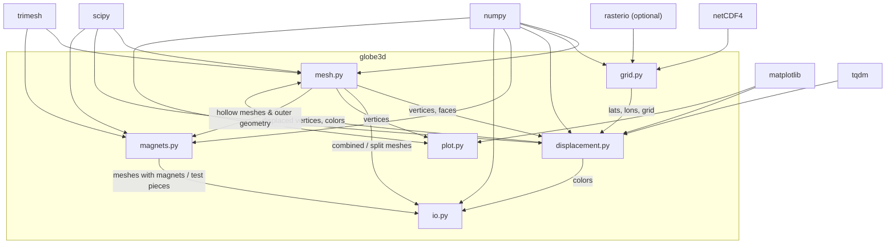
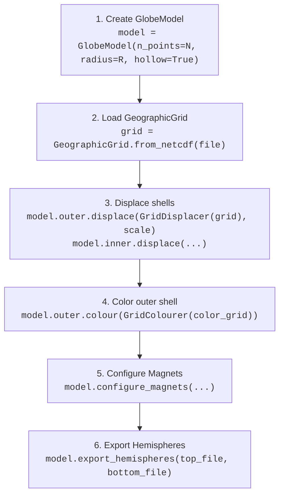

# Developer Guide — globe3d

Welcome to the `globe3d` project. This guide provides a comprehensive architectural walkthrough of the library, its modules, the data pipeline from raw geographic grids to 3D-printable models, and the conventions that keep the codebase healthy.

> **See also:** The repository-level [`AGENTS.md`](AGENTS.md) contains environment setup, Conda activation instructions, and CI/testing commands.

---

## 📖 Overview

`globe3d` is a Python package that turns geographic grid data (elevation, seismic tomography, or any other spherical field) into physical, 3D-printable globe models with exaggerated topography and optional vertex coloring. The typical output is a pair of OBJ hemisphere files, ready for full-color FDM or SLA printing.

### Key capabilities

| Capability | Module / Class | Entry Point(s) / Methods |
|---|---|---|
| Globe model state & orchestration | `mesh.py` / `GlobeModel` | `GlobeModel(...)`, `GlobeModel.from_paleo(...)`, `model.outer.displace`, `model.inner.displace`, `model.outer.colour` |
| Deep-time plate reconstructions | `reconstruction.py` / `PlateModel` | `PlateModel(...)`, `reconstruct_points(...)`, `reconstruct_grid(...)` |
| Paleo datasets & epoch catalog | `datasets.py` / `datasets.paleo` | `datasets.paleo.scotese(...)`, `datasets.paleo.scotese_plate_model(...)`, `datasets.paleo.list_scotese_maps()` |
| Vector SVG stamping & image prep | `image.py` | `add_svg_symbol_spherical(...)`, `add_pole_markers(...)`, `undo_hillshading(...)`, `simplify_colors(...)`, `simplify_image_median(...)` |
| Filament optical mixing & palettes | `filaments.py` | `mix_filament_pair(...)`, `mix_filaments(...)`, `create_filament_palette(...)`, `match_filament_color(...)` |
| Banded colormaps for 3D slicing | `filaments.py` / `image.py` | `create_banded_colormap(...)`, `create_elevation_banded_colormap(...)`, `apply_banded_colormap(...)` |
| Domain presets & spool libraries | `presets.py` | `FILAMENT_PRESETS`, `DEFAULT_ELEVATION_BANDS`, `DEFAULT_ELEVATION_BOUNDARIES`, `get_printer_profile(...)` |
| Interactive Jupyter widgets & GUI | `widgets.py` | `InteractiveColormapBuilder(...)` |
| Geographic grid loading & representation | `grid.py` / `GeographicGrid` | `GeographicGrid.from_netcdf`, `GeographicGrid.from_tiff`, `GeographicGrid.list_netcdf_variables` |
| Radial displacement of vertices | `displacement.py` / `Displacer` | `GridDisplacer` (with `coastline_step`), `PointDisplacer`, `LineDisplacer`, `PolygonDisplacer` |
| Vertex coloring (grid, image, symbols, poles) | `displacement.py` / `Colourer` | `GridColourer`, `ImageColourer` (file/PIL/array), `SymbolColourer` (SVG/shapes, `modern`/`paleo`), `PoleLabelColourer` (undistorted 'N'/'S'), `ConstantColourer` |
| Displacement scale (unit-aware) | `displacement.py` | `calculate_displacement_scale(model_radius_mm, grid_units=...)` |
| Magnet configuration | `mesh.py` / `GlobeModel` | `model.configure_magnets(...)` |
| Hemisphere generation | `mesh.py` / `GlobeModel` | `model.generate_hemispheres(...)`, `model.export_hemispheres(...)` |
| File export (STL, OBJ & OrcaSlicer 3MF) | `mesh.py` / `io.py` | `model.export(...)`, `model.export_hemispheres(...)`, `model.write_3mf(...)`, `write_3mf(...)`, `model.write_stl`, `model.write_obj` |
| Visual QA & 3D Preview | `plot.py` / `filaments.py` | `plot_globe_preview(...)`, `plot_vertex_distribution(...)`, `plot_filament_palette(...)`, `plot_banded_colormap_preview(...)` |

---

## 🏗️ Architecture

### Project layout

```
3D_globes/
├── AGENTS.md                  # Environment & CI guidance for agents
├── DEVELOPER_GUIDE.md         # ← you are here
├── README.md
├── pyproject.toml             # Build config (setuptools)
├── setup.py
├── src/
│   └── globe3d/
│       ├── __init__.py        # Public API re-exports
│       ├── mesh.py            # Sphere generation, hollowing, splitting, GlobeModel.from_paleo
│       ├── grid.py            # NetCDF / TIFF data loading
│       ├── displacement.py    # Vertex displacement & coloring
│       ├── reconstruction.py  # GPlately/PyGPlates deep-time plate reconstructions
│       ├── image.py           # Spherical SVG stamping & texture preprocessors
│       ├── filaments.py       # Full-spectrum optical filament mixing & banded colormaps (Headless Backend)
│       ├── presets.py         # Domain presets, base filament libraries & default elevation bands
│       ├── widgets.py         # Interactive Jupyter widgets & frontend GUI (InteractiveColormapBuilder)
│       ├── datasets.py        # Modern Earth/planetary/geophysics & paleo datasets
│       ├── magnets.py         # Optimization & insertion of magnets
│       ├── io.py              # STL, OBJ & multi-color 3MF export (OrcaSlicer filament mixing)
│       ├── plot.py            # Matplotlib visual checks & 3D mesh preview
│       └── assets/            # Builtin SVGs (N, S, star), map metadata & filament weights
├── tests/
│   ├── test_mesh.py
│   ├── test_model_api.py
│   ├── test_displacement.py
│   ├── test_grid.py
│   ├── test_magnets.py
│   ├── test_reconstruction.py
│   ├── test_image.py
│   ├── test_paleo_datasets.py
│   ├── test_filaments.py
│   └── test_notebooks.py
└── examples/
    ├── example_1_basic_globe.ipynb
    ├── example_2_intermediate_globe.ipynb
    ├── example_3_magnets_globe.ipynb
    ├── example_4_coloured_globe.ipynb
    ├── example_5_colouring.ipynb
    └── example_6_paleo_globe.ipynb
```

### Dependency graph



Modules are intentionally loosely coupled: `grid.py` knows nothing about meshes, `displacement.py` knows nothing about file formats, and `io.py` knows nothing about grids. Communication happens through numpy arrays passed by the caller (typically a notebook).

---

## 🔬 Module-by-Module Reference

### `mesh.py` — Geometry Generation & Processing

This module defines the central **`GlobeModel`** class and the lightweight **`_MeshProxy`** class. Together they encapsulate the outer/inner geometry, displacement/colouring recipes, magnet settings, and export orchestration.

#### `GlobeModel` Unified Constructor

```python
GlobeModel(
    method='fibonacci',          # 'fibonacci' or 'icosahedron'
    n_points=100000,             # outer-shell vertices (fibonacci)
    radius=40.0,                 # globe radius in mm
    center=(0.0, 0.0, 0.0),
    subdivisions=None,           # icosahedron only
    hollow=False,                # auto-generate inner mesh
    inner_ratio=0.8,             # inner radius fraction
    inner_n_points=None,         # inner vertices (default: n_points // 5)
)
```

When `hollow=True`, both outer and inner sphere meshes are generated automatically by the constructor — no manual property setting required.

**Backward-compatible factory methods** are preserved as convenience wrappers:
- `GlobeModel.from_fibonacci(n_points, radius, center)`
- `GlobeModel.from_icosahedron(subdivisions, radius, center)`

#### `_MeshProxy` — Inner/Outer Shell Access

`model.outer` and `model.inner` return `_MeshProxy` instances with:
- **Read-only properties**: `vertices`, `faces`, `colors`
- **Mutating methods**: `displace(displacer, scale)`, `colour(colourer, selection, ...)`

Displacement and colouring steps are recorded in **separate recipes** for the outer and inner shells (`model.recipe` and `model._inner_recipe`). Both recipes are re-applied automatically when `generate_hemispheres()` creates new vertices via boolean operations.

#### `GlobeModel` Convenience Aliases

- `model.displace(displacer, scale=1.0)` — alias for `model.outer.displace(...)`.
- `model.colour(colourer, ...)` — colors the specified target (`'all'`, `'outer'`, or `'inner'`). Defaults to `'all'`.

#### Shell Thickness & Intersection Resolution

- `model.fix_intersection(min_thickness=1.2, mode="inner")` — resolves shell thickness violations and intersections by displacing vertices radially inward, outward, or both symmetrically.

#### Magnet Configuration

- `model.configure_magnets(**kwargs)` — creates a `MagnetSettings` instance from keyword arguments.

#### Hemisphere Generation

- `model.generate_hemispheres(hollow=True, thickness=1.5, engine=None, ...)` — splits and hollows the model, inserts magnets (if configured), re-applies colour recipes, returns `(top, bottom)` trimesh objects.

#### Export Methods

- `model.export(filename, part='outer')` — exports to STL/OBJ (format inferred from extension).
- `model.export_hemispheres(top_filename, bottom_filename, ...)` — full pipeline: split → hollow → magnets → color → write. The highest-level helper.
- `model.write_stl(filename, part)` — low-level STL export.
- `model.write_obj(filename, part, fix_normals=False)` — low-level OBJ export with vertex colors.

#### Hollowing & Splitting Helpers (Internal)

- `create_hollow_hemispheres(...)`: Recommended split-first, hollow-second boolean engine pipeline.
- `combine_subtractive_globes(...)`: Fast and deterministic subtraction by concatenation and inverted chirality of inner shell.
- `hollow_mesh(...)`: Whole-globe boolean difference.
- `split_mesh_hemispheres(...)`: Splits and caps a mesh.

---

### `grid.py` — Geographic Grid Loading

This module defines the **`GeographicGrid`** class, representing geographic coordinates (`lats`, `lons`) and a 2D scalar grid of data. Coordinates are validated and automatically sorted in ascending order upon creation.

#### `GeographicGrid` Creators & Utilities

- `GeographicGrid(lats, lons, grid)`: Initializes a `GeographicGrid` and validates dimensions, uniqueness, and shape consistency.
- `GeographicGrid.from_netcdf(filename, lat_var='lat', lon_var='lon', data_var='z')`: Loads grid data from a NetCDF4 file.
- `GeographicGrid.from_tiff(filename)`: Loads grid data from a GeoTIFF file using `rasterio`.
- `GeographicGrid.list_netcdf_variables(filename)`: Static helper to list available variables in a NetCDF4 file.

---

### `datasets.py` — Datasets Fetcher & Cacher

This module provides fetching, caching, and preprocessing capabilities for standard global geophysical datasets and shapefiles. It organizes them into a clean, hierarchical API:

- **`datasets.topography`** (Earth, Mars, Moon, Venus, Mercury, ETOPO, GEBCO)
- **`datasets.tomography`** (S40RTS)
- **`datasets.geoid`** (EGM2008)
- **`datasets.crust`** (CRUST1.0)
- **`datasets.dynamic_topography`** (Hoggard 2016)
- **`datasets.gravity`** (Bouguer Anomaly)
- **`datasets.magnetics`** (EMAG2v3)
- **`datasets.shapefiles`** (Natural Earth land and coastline vector data)
- **`datasets.lithosphere`** (LITHO1.0 lithospheric thickness model)

#### Helper Methods & Functions

- `list_datasets()`: Returns a dictionary of all available datasets grouped by category.
- `lithosphere.thickness(parameter="total", as_meters=True)`: Loads LITHO1.0 lithospheric thickness parameter as a grid (values in meters by default). Supports `"total"` thickness, `"lid"` mantle lid thickness, and `"lab"` boundary depth.
- `shapefiles.land()`: Returns the absolute path to the extracted `ne_110m_land.shp` shapefile, downloading and extracting it if not cached.
- `shapefiles.coastline()`: Returns the absolute path to the extracted `ne_110m_coastline.shp` shapefile, downloading and extracting it if not cached.

---

### `displacement.py` — Radial Displacement & Vertex Coloring

This is where the geographic data meets the 3D geometry (~229 lines).

#### Coordinate conventions

The library uses a right-handed Cartesian system centred at the origin:
- **x** → 0° longitude (prime meridian)
- **y** → 90° E longitude
- **z** → north pole

Conversion from Cartesian to geographic:
```
r   = ‖(x, y, z)‖
lat = arcsin(z / r)       (degrees)
lon = atan2(y, x)          (degrees)
```

This convention is consistent across `displace_vertices`, `assign_vertex_colors`, `assign_vertex_colors_image`, and `plot_vertex_distribution`.

#### Dateline wrapping (`_wrap_longitude`)

An internal helper that pads the longitude axis and grid to handle interpolation across the ±180° dateline. It replicates the first/last column of the grid at the opposite boundary with appropriate longitude offsets so that `RegularGridInterpolator` has continuous data across the seam.
### `displacement.py` — Radial Displacement & Vertex Coloring

This module handles radial vertex displacement and vertex coloring using an object-oriented class hierarchy.

#### Displacer Hierarchy

All displacement classes inherit from the base `Displacer` class and are callable with `__call__(vertices, scale=1.0)`.

- **`GridDisplacer(grid, num_threads=-1, interp_method='linear')`**
  Displaces vertices radially based on a `GeographicGrid` interpolation.
- **`PointDisplacer(points_data, displacement, radius_degrees=1.0, num_threads=-1)`**
  Displaces vertices close to discrete points. `points_data` can be a shapefile path or an `(N, 2)` array of `(lon, lat)`.
- **`LineDisplacer(shapefile_path, displacement, width_degrees=1.0, num_threads=-1)`**
  Displaces vertices within a ribbon width of line features.
- **`PolygonDisplacer(shapefile_path, displacement, displace_inside=True, num_threads=-1)`**
  Displaces vertices that fall inside (or outside) closed polygons.

All displacement classes validate that no vertex is translated deeper than or to the origin (i.e. new radius <= 0), raising a `ValueError` if a displacement is invalid.

#### Colourer Hierarchy

All coloring classes inherit from the base `Colourer` class and are callable with `__call__(vertices)`. They return an `(N, 3)` RGB float64 array in range `[0, 1]`.

- **`GridColourer(grid, colormap='viridis', norm=None, vmin=None, vmax=None, num_threads=-1, interp_method='linear')`**
  Samples a geographic grid and maps the values through a Matplotlib colormap.
- **`ImageColourer(image_path)`**
  Maps an equirectangular image to the sphere vertices using nearest-neighbor lookup.
- **`ConstantColourer(color=[1.0, 1.0, 1.0])`**
  Applies a solid, single RGB color.

#### Selection Functions & Registry

- `select_inward_facing(vertices, faces)`: Identifies vertices belonging to inward-facing faces.
- `select_outward_facing(vertices, faces)`: Identifies vertices belonging to outward-facing faces.
- `register_selection_function(name, func)`: Registers a custom selection callable to the global `SELECTION_REGISTRY`. Registered names can be passed directly as strings to `model.colour()`.

---

### `magnets.py` — Magnet Insertion & Position Optimization

This module manages the placement and insertion of magnets into globe hemispheres so they can be magnetically assembled. It uses bisection search to find the optimal magnet positions directly from the outer 3D geometry of the globe, with no dependency on raw grids or scale parameters.

#### Position Optimization

**`optimize_magnet_positions(longitudes, outer_mesh, r_enc, h_boss, bisection_iters)`**

For each target longitude on the equatorial cut plane, this function uses a bisection search (binary search) to find the maximum distance $d$ from the origin where a boss cylinder of radius `r_enc` and height `h_boss` is completely contained within the outer sphere's displaced surface.
- Checks containment at multiple check-points on the top and bottom caps of the boss cylinder.
- Uses `outer_mesh.contains(global_pts)` to perform fast and precise geometric containment checks directly on the watertight displaced outer mesh.
- Returns a list of optimized `(x, y)` center coordinates.

**`find_valid_magnet_positions_no_bosses(outer_mesh, inner_mesh, r_enc, h_boss, step_degrees=2, n_magnets=3, min_magnets=2, min_angular_spacing=60.0, placement_strategy='cluster_peaks', angle_tolerance=0.0, allow_bosses=False, return_details=False, ...)`**
*(Also aliased as `find_optimized_magnet_positions`)*

Evaluates candidate longitudes on the equatorial cut-plane ($Z = 0$) and tests containment of candidate magnet voids within the hollowed globe (inside `outer_mesh` and outside `inner_mesh`).
- **Dual-Bisection Search**: Uses independent monotonic bisections for inner shell clearance ($d_{min}$) and outer shell containment ($d_{max}$).
  - If $d_{min} \le d_{max}$, the void fits cleanly within the natural shell thickness without adding a boss, and the magnet is centered at $d = (d_{min} + d_{max}) / 2$ to maximize clearance from both walls.
  - If $d_{min} > d_{max}$ and `allow_bosses=True`, the void is placed at $d = d_{max}$ to push the magnet as far outward into the outer shell as possible, minimizing cavity intrusion depth (and minimizing added plastic material).
- **Boss Minimization (`allow_bosses=True`)**:
  - **Stage 1**: The algorithm first attempts to place the requested magnets using **zero bosses** across the valid shell locations.
  - **Stage 2**: If the shell cannot accommodate all magnets without bosses, a branch-and-bound backtracking optimizer selects angles that **minimizes the number of bosses**, **minimizes the protrusion into the cavity** (material added), and balances angular spacing uniformity.
- **Placement Strategies**:
  - `'cluster_peaks'` (default): Groups contiguous valid longitudes into continental clusters (handling circular 360° wraparound) and selects the peak wall clearance point in each cluster, prioritizing structural strength. Falls back to uniform spacing if fewer clusters exist than requested magnets.
  - `'uniform'`: Backtracks across all valid angles to maximize angular spacing uniformity (minimizing variance from $360^\circ / k$).
  - `'margin_weighted'`: Optimizes a combined objective balancing angular spacing uniformity and wall clearance margin.
- **Angle Nudging**: If explicit candidate angles are passed via `candidate_angles` (or `position`) and an angle is slightly outside the solid shell, `angle_tolerance` allows searching within a local window $[\theta - \Delta, \theta + \Delta]$ to find the nearest valid position (or minimize protrusion).
- Raises `ValueError` if `allow_bosses=False` and no candidate positions fit the void, or if fewer than `min_magnets` can be placed respecting `min_angular_spacing`.

#### Magnet Insertion

**`insert_magnets_into_hemispheres(top_mesh, bottom_mesh, outer_vertices, outer_faces, diameter, height, n_magnets, position, allow_bosses=True, ...)`**

Orchestrates the boolean modification of the top and bottom hollow hemispheres:
1. Determines longitudes for the magnets (either a start longitude or explicit positions).
2. Optimizes the magnet centers on the XY cut plane:
   - When inner shell geometry is provided, calls `find_valid_magnet_positions_no_bosses(..., allow_bosses=allow_bosses, return_details=True)`.
   - When `allow_bosses=True`, automatically minimizes the number of bosses needed and avoids adding bosses where the natural shell is thick enough.
   - If `inner_vertices is None` (e.g. solid globe core), uses `optimize_magnet_positions` directly.
3. Generates the boss cylinders and void cylinders:
   - Boss cylinders are **only generated for the specific magnets that require bosses** (`needs_boss == True`). If no magnets require bosses (or `allow_bosses=False`), the boolean union operation is skipped entirely, keeping the inner cavity smooth and accelerating processing.
   - For the top hemisphere, any needed bosses are unioned and voids are subtracted.
   - For the bottom hemisphere, corresponding bosses are unioned and voids are subtracted.
4. Performs boolean operations using the `trimesh` boolean engine (e.g., `'manifold'`).
5. Returns a tuple of `(top_mesh_with_magnets, bottom_mesh_with_magnets)`. Note: `add_bosses` is supported as a backward-compatible alias for `allow_bosses`.

#### Calibration Test Piece

**`generate_magnet_test_piece(diameter, height, horizontal_tolerance, vertical_tolerance, vertical_offset, min_thickness, output_path)`**

Generates a simple cylinder containing a single magnet void. Useful for test-printing to verify tolerances before printing a large globe.

---

### `io.py` — File Export

Three export formats chosen based on printer hardware, slicer capabilities, and color requirements:

#### `write_stl_binary(filename, vertices, faces)`

Writes a standard binary STL. Each triangle is stored with its computed face normal (cross product of two edge vectors). No color support — suitable for single-material prints.

#### `write_obj_with_vertex_colors(filename, vertices, faces, colors, center, fix_normals)`

Writes an OBJ file using the vertex-color extension (`v x y z r g b`). OBJ indices are 1-based.

#### `write_3mf(filename, vertices=None, faces=None, colors=None, objects=None, base_filaments=None, palette=None, ...)`

Generates a standards-compliant Open Packaging Conventions (OPC) 3MF package with full Materials & Properties Extension support (`xmlns:m="http://schemas.microsoft.com/3dmanufacturing/material/2015/02"`) and native **OrcaSlicer / Snapmaker Orca / Bambu Studio multi-filament mixing compatibility**:
- **Multi-Object Packaging**: Supports single or multi-mesh export (via `objects=[{'name': ..., 'vertices': ..., 'faces': ..., 'colors': ...}, ...]`). Used by `model.export_hemispheres(top_filename='globe.3mf', bottom_filename=None)` to package both Northern and Southern hemispheres side-by-side on the print bed with flat equatorial cuts at $Z=0$.
- **Physical Spools vs. Virtual Mixed Filaments**: In FullSpectrum slicing, `Metadata/project_settings.config` registers **only the physical hardware spools** in `filament_colour` (e.g. 4 spools: Brown, Dark Blue, White, Dark Green) to prevent the slicer from treating virtual shades as physical AMS filaments. All virtual optical blends are encoded as `mixed_filament_definitions` rows following the FullSpectrum specification (`component_a,component_b,enabled,custom,mix_b_percent,pointillism,g<ids>,w<weights>,m<mode>,d<deleted>,o<origin>,u<stable_id>[,manual_pattern]`).
- **16-Slot Hard Ceiling Enforcement**: OrcaSlicer / Snapmaker Orca supports at most 16 extruder slots. If a model defines or paints facets with extruders $> 16$, the slicer silently wraps or defaults to Extruder 1. `write_3mf` strictly limits total slots to $\le 16$ by pruning unused virtual palette combinations to only the active elevation bands referenced by the mesh objects.
- **Pure White Snapping**: In digital meshes, symbols, polar 'N'/'S' glyphs, and cut faces are often colored pure white `(255, 255, 255)`. To prevent spurious duplicate slots or accidental fallback to Extruder 1, any near-white color ($R, G, B \ge 240$) automatically snaps directly to the loaded physical White spool (e.g. Extruder 3).
- **Micro-Layer Pattern Interleaving**: To maximize optical dispersion and prevent color banding artifacts, multi-material micro-layer sequences are interleaved: 50/50 two-spool blends strictly alternate layer-by-layer (e.g. `BWBW` rather than `BBWW`), and 50/25/25 three-spool blends interleave the dominant spool so no two adjacent micro-layers share the same filament (e.g. `BWBG` rather than `BBWG`).
- **Geometry & Colorgroups / Multi-Color Painting**: Generates `3D/3dmodel.model` declaring `<m:colorgroup id="1">` with exact sRGB hex colors (`#RRGGBBAA`) mapped directly to mesh triangles via `pid="1" p1="{idx}"`. For native OrcaSlicer / Bambu Studio / Snapmaker Orca multi-color rendering, each triangle also embeds the proprietary `paint_color="{paint_code}"` attribute (generated via `encode_paint_facet`) mapping each facet to physical AMS spools (1..4) and virtual optical mixed slots (5..N), preventing the model from falling back to solid uniform default extruder appearance.
- **Model Metadata**: Embeds `Metadata/model_settings.config` linking the object and plate hierarchy.
- **Round-Trip Compatibility**: Files can be opened directly in OrcaSlicer or Bambu Studio with all slots pre-configured and mesh colors vividly displayed, or imported into CAD tools like Blender, FreeCAD, and standard 3MF viewers.

> [!IMPORTANT]
> The `fix_normals` parameter defaults to **False**.  For manifold meshes from boolean operations (e.g. `create_hollow_hemispheres`), normals are already correct and must **not** be overridden — `fix_face_chirality` would flip the inner shell's faces outward, destroying the manifold and causing slicers to fill the hollow.  Set `fix_normals=True` only for simple convex meshes.

**Internal helper:**

`fix_face_chirality(vertices, faces, center)` iterates over every face, computes the face normal via cross product, and checks whether the normal points toward or away from `center` (via dot product with the centroid-to-centre vector). Faces pointing inward are flipped by swapping the last two vertex indices.

---

### `filaments.py` — Optical Filament Mixing & Banded Colormaps (Headless Backend)

This module operates strictly as a headless backend for simulating physical multi-material 3D printing optical layer mixing and hypsometric elevation categorization:
- **Optical Mixing Engine**: Degree-4 Kubelka-Munk polynomial model predicting perceived optical color blending across semi-translucent base filaments with transmission distances (`td`).
- **`create_filament_palette`**: Generates printable discrete mixtures across loaded base spools (supports strict N-layer blends e.g. `total_layers=4` and custom ratio lists).
- **`create_banded_colormap` / `apply_banded_colormap`**: Generates and applies discrete segmented hypsometric colormaps with automatic latitude axis orientation (`flip_y=True` by default for equirectangular grids with North at the top).
- **`plot_filament_palette`**: Visualizes palette swatches with bold, luminance-aware integer index labeling (`show_index=True`) for easy reference in colormaps.
- **`plot_banded_colormap_preview`**: Renders discrete horizontal colorbars with uniform segment spacing (`spacing="uniform"`) so narrow elevation zones remain distinct and readable.

---

### `presets.py` — Centralized Domain Presets & Spool Libraries

Houses domain defaults and presets so that core calculation modules remain clean and unencumbered by hardcoded configurations:
- **`FILAMENT_PRESETS`**: Preconfigured physical spool bundles (`TERRAIN_4`, `CMYKW`, `RBYKW`) with calibrated optical transmission distances (`td`).
- **`DEFAULT_ELEVATION_BOUNDARIES`**: Default geological threshold values (e.g. `[-1500, -250, 0, 150, 450, 950, 1500]` meters).
- **`DEFAULT_ELEVATION_BANDS`**: Default zone metadata, naming, and 4-layer optical recipes.

---

### `widgets.py` — Interactive Jupyter Widgets & GUI (Frontend)

Keeps frontend interactive code strictly isolated from backend computational logic:
- **`InteractiveColormapBuilder`**: Interactive `ipywidgets` GUI providing live dropdown selection of filament mixtures, threshold inputs, dynamic addition and removal of elevation bands, and real-time dual previews of both the colorbar and the 2D equirectangular map.


---

### `plot.py` — Visual QA

A single utility function (~31 lines):

**`plot_vertex_distribution(vertices, title, sample_size)`**

Converts vertex positions to `(lat, lon)` and plots them as a scatter plot. For large meshes, a random subset of `sample_size` points is shown to keep rendering fast.

---

### `__init__.py` — Public API

Re-exports the core OOP interface classes and helpers:

- **Classes**: `GeographicGrid`, `GlobeModel`, `MagnetSettings`, `Displacer`, `GridDisplacer`, `PointDisplacer`, `LineDisplacer`, `PolygonDisplacer`, `Colourer`, `GridColourer`, `ImageColourer`, `ConstantColourer`, `SymbolColourer`, `PoleLabelColourer`, `PlateModel`, `InteractiveColormapBuilder`
- **Helpers & Registries**: `calculate_displacement_scale`, `select_inward_facing`, `select_outward_facing`, `register_selection_function`, `cartesian_to_spherical`, `plot_vertex_distribution`, `plot_globe_preview`, `generate_magnet_test_piece`, `create_filament_palette`, `create_banded_colormap`, `create_elevation_banded_colormap`, `apply_banded_colormap`, `plot_filament_palette`, `plot_banded_colormap_preview`, `reconstruct_points`, `reconstruct_grid`
- **Subpackages**: `datasets`, `image`, `reconstruction`, `filaments`

Internal helpers (`_MeshProxy`, `_UNIT_TO_METERS`, `_wrap_longitude`, etc.) are not exported and should not be imported directly by users.

---

## 🔄 End-to-End Pipeline

The following diagram shows the full data-flow in v3.0 for producing a 3D-printable, colored, hollow, split globe using the new OOP interface:



### Step-by-step (with reference parameters)

#### 1. Generate base model

```python
from globe3d import GlobeModel, GeographicGrid
from globe3d import GridDisplacer, PointDisplacer, LineDisplacer, PolygonDisplacer
from globe3d import GridColourer, ImageColourer, ConstantColourer
from globe3d import calculate_displacement_scale
import matplotlib.pyplot as plt

model_radius_mm = 50.0
model = GlobeModel(
    method='fibonacci',
    n_points=1_000_000,
    radius=model_radius_mm,
    hollow=True,
    inner_ratio=0.8,
    inner_n_points=20_000,
)
```

The constructor generates both outer and inner meshes when `hollow=True`. No manual property setting required.

#### 2. Load the geographic grid

```python
topo_grid = GeographicGrid.from_netcdf(
    "ETOPO_2022_v1_60s_N90W180_surface.nc",
    lat_var='lat', lon_var='lon', data_var='z'
)
```

For the coloring grid (if separate from the displacement grid):

```python
color_grid = GeographicGrid.from_netcdf(
    "s40_depth_slice_2850.grd",
    lat_var='y', lon_var='x', data_var='z'
)
```

#### 3. Displace shells

```python
# Compute scale factor — ETOPO data is in meters:
topo_units = 'm'
vertical_exagg = 30.0
scale = calculate_displacement_scale(model_radius_mm, vertical_exagg=vertical_exagg, grid_units=topo_units)

# Displace outer and (optionally) inner shells:
model.outer.displace(GridDisplacer(topo_grid), scale=scale)
model.inner.displace(GridDisplacer(tomo_grid), scale=-1.5 * 0.8)
```

The inner shell can be displaced independently using `model.inner.displace(...)`. Its recipe is tracked separately.

> [!IMPORTANT]
> **Displacement Validation**: All displacement classes validate that no vertex is translated deeper than or to the origin. If a negative displacement exceeds the vertex's current distance from the origin (new radius <= 0), a `ValueError` is raised.

#### 3.5. Specialized Shapefile & Coordinate Displacement (optional)

Depending on the geometry type, you can apply one of the specialized displacers:

##### A. Points & Coordinate Lists (`PointDisplacer`)
Displaces vertices close to discrete points (either a shapefile containing Point/MultiPoint geometries or an `(N, 2)` array/list of `(lon, lat)`):
```python
model.displace(PointDisplacer("../inputs/my_points.shp", displacement=1.5, radius_degrees=1.0))
```

##### B. Lines & Borders (`LineDisplacer`)
Displaces vertices close to line or polygon boundaries:
```python
model.displace(LineDisplacer("../inputs/coastlines/ne_110m_coastline.shp", displacement=1.0, width_degrees=0.5))
```

##### C. Closed Polygons (`PolygonDisplacer`)
Displaces vertices inside or outside closed polygons (Polygons/MultiPolygons):
```python
model.displace(PolygonDisplacer("../inputs/land/ne_110m_land.shp", displacement=1.0, displace_inside=True))
```

#### 4. Color the model

```python
# Grid-based coloring (outward-facing surfaces only)
colourer = GridColourer(color_grid, colormap=plt.get_cmap('RdBu_r', 7), vmin=-2, vmax=2)
model.outer.colour(colourer, selection='outward_facing')

# OR image-based coloring
# model.outer.colour(ImageColourer('texture.png'))

# Modular vector symbols (supports 'modern' with plate reconstruction or 'paleo')
model.outer.colour(SymbolColourer(
    symbol="star",
    lat=51.7519, lon=-1.2578, # Oxford, UK
    reference="modern",
    age=250.0,
    color="red",
    radius_degrees=3.0,
))

# Modular polar labels (tangent-plane projection, zero pole distortion)
model.outer.colour(PoleLabelColourer(
    radius_degrees=3.5,
    north_color="red",
    south_color="blue",
))
```

#### 5. Configure magnets (optional)

```python
model.configure_magnets(diameter=5.0, height=2.0, n_magnets=3)
```

#### 6. Export hemispheres

```python
# Full pipeline in one call: split → hollow → magnets → color → write
model.export_hemispheres(
    'globe_top.obj', 'globe_bottom.obj',
    engine='manifold'
)
```

---

## 📓 Example Notebooks

Eight example notebooks live in `examples/`:

| Notebook | Purpose |
|---|---|
| `example_1_basic_globe.ipynb` | Minimal topography-only globe → STL |
| `example_2_intermediate_globe.ipynb` | Coastline step + hemisphere splitting → STL |
| `example_3_magnets_globe.ipynb` | Magnet void insertion (with and without bosses) |
| `example_4_coloured_globe.ipynb` | Full pipeline: displacement + color + magnets → OBJ |
| `example_6_paleo_globe.ipynb` | Deep-time paleo-globes (0-540 Ma), 4-filament optical mixing, banded colormaps & interactive 3D WebGL preview |
| `tomo_globe_3d.ipynb` | Production tomography globe with all features |
| `demo_magnets.ipynb` | Magnets demo with calibration test piece |
| `demo_split_globe_image.ipynb` | Image-based coloring demo |

All notebooks use the unified `GlobeModel(...)` constructor and `model.outer.displace(...)` / `model.export_hemispheres(...)` API.

---

## 📐 Key Concepts & Design Decisions

### Coordinate system

The library uses a **right-handed Cartesian** system centred at the origin, with the z-axis through the north pole. This matches the mathematical convention for spherical coordinates and ensures consistency with `ConvexHull` and `trimesh`.

### Units

The canonical working unit is **millimetres** for model space (radii, displacements) because 3D printers universally use mm. Real-world grid data can be in any of the supported units (`m`, `km`, `cm`, `mm`, `ft`). The `calculate_displacement_scale` function accepts a `grid_units` parameter (default `'m'`) and applies the correct conversion factor internally:

```python
scale = calculate_displacement_scale(model_radius_mm, vertical_exagg=50, grid_units='m')
```

### Why three hollowing approaches?

**Boolean hemisphere pipeline** (`create_hollow_hemispheres`) is the recommended approach for 3D printing. It splits the outer mesh first, then boolean-subtracts the inner sphere from each half. This produces properly manifold, watertight hemispheres. The boolean operation is performed by the `manifold3d` engine (or Blender as a fallback).

**Subtractive combination** (`combine_subtractive_globes`) is fast and deterministic — it simply concatenates vertex and face arrays with inverted chirality on the inner shell. It produces a mesh that *looks* hollow and is suitable for whole-globe visualisation. However, **it cannot be combined with `split_mesh_hemispheres`** for 3D printing because the equatorial cap seals the inner cavity.

**Boolean difference** (`hollow_mesh`) performs a whole-globe boolean subtraction. Useful for exporting a complete hollow globe without splitting, but slower and more fragile than the subtractive approach.

### Face chirality

In STL and OBJ, the **winding order** of a triangle's vertices determines the direction of its face normal (right-hand rule). Outward-pointing normals are essential for correct slicer behaviour. The library handles this in several places:
1. `generate_sphere_points_fibonacci` / `generate_sphere_points_icosahedron` — use `_fix_sphere_normals()`, a fast vectorised dot-product check, to guarantee outward normals.
2. `invert_chirality` — used by `combine_subtractive_globes` to flip the inner shell's normals inward.
3. `fix_face_chirality` — available via `write_obj_with_vertex_colors(fix_normals=True)` for simple convex meshes. **Not applied by default** to avoid destroying manifold geometry from boolean operations.
4. `create_hollow_hemispheres` — calls `trimesh.fix_normals()` on both input meshes before boolean operations.

### Vertex colors in OBJ

The OBJ format does not have a formal vertex color standard, but a widely supported convention appends `r g b` values to each `v` line: `v x y z r g b`. This is supported by MeshLab, Blender, and PrusaSlicer / BambuStudio / OrcaSlicer.

### Fibonacci vs icosahedron

| | Fibonacci | Icosahedron |
|---|---|---|
| **Density uniformity** | Very good (near-uniform) | Excellent (exactly uniform triangles) |
| **Vertex count control** | Continuous (any `n`) | Discrete (exponential growth with subdivisions) |
| **Typical use** | High-resolution production globes | Lower-resolution or algorithmically regular meshes |
| **Face generation** | `ConvexHull` (may produce slivers near poles) | Recursive subdivision (all triangles similar) |

For 3D printing, the Fibonacci lattice at ~1M points is the standard choice.

### `reconstruction.py` — Deep-Time Plate Tectonic Reconstructions

This module integrates GPlately and PyGPlates to reconstruct geographic coordinates, vectors, and scalar grids across deep geological time (Ma).

Key classes and functions:
- **`PlateModel`**: Encapsulates a GPlately plate reconstruction model. Loads rotation models (`.rot`) and topology/polygons (`.gpml`), or downloads models via `gplately.DataServer` (`Muller2019`, `Merdith2021`, `Cao2020`).
- **`reconstruct_points(points, plate_model, age_ma)`**: Vectorized coordinate reconstruction mapping modern $(lat, lon)$ points back to their paleo-coordinates at age $T$ Ma.
- **`reconstruct_grid(grid, plate_model, age_ma)`**: Reconstructs a `GeographicGrid` or 2D NumPy array to age $T$ Ma using topology plate partitioning.

### `image.py` — Spherical Vector Symbols & Texture Preprocessing

This module provides tools for 3D print texture preparation and spherical vector stamping:
- **`add_svg_symbol_spherical`**: Parses SVG files or XML strings, scales them by angular radius in degrees, and projects them spherically onto equirectangular maps using great-circle interpolation and polar projection.
- **`add_pole_markers`**: Automatically stamps 'N' and 'S' vector symbols onto the North and South poles ($\pm 89.9999^\circ$) to provide unambiguous hemisphere orientation.
- **`undo_hillshading`**: Normalizes Lightness in HSL space to flatten artificial lighting and shadows from published atlas maps, avoiding duplicate shadows on physical 3D relief.
- **`simplify_image_median` & `simplify_image_bilateral`**: Smooths flat regions and eliminates single-pixel noise islands while preserving sharp coastlines.
- **`simplify_colors`**: Quantizes continuous RGB textures to a discrete set of filament colors via weighted HSV distance for multi-material FDM slicing (Bambu AMS / Prusa MMU).
- **`render_2d_array_as_rgb`**: Converts a 2D scalar array into an RGB image mapped through discrete boundary thresholds.

### `datasets.py` — Geophysical & Paleogeographic Data Catalog

Provides namespaces for standard datasets:
- **`datasets.paleo`**: Catalog of 108 Scotese & Wright (2018) PALEOMAP PaleoDEM elevation grids and matching PaleoAtlas full-color textures spanning 0 to 540 Ma.
  - `datasets.paleo.scotese(age=...)`: Automatically locates and loads the closest PaleoDEM grid and texture.
  - `datasets.paleo.scotese_plate_model()`: Returns the initialized Scotese PALEOMAP `PlateModel`.
  - `datasets.paleo.list_scotese_maps()`: Lists all 108 registered time slices.

### `io.py` & Multi-Color 3MF Export (OrcaSlicer & Snapmaker U1)

`globe3d` includes a native 3MF exporter designed for multi-material slicing and micro-layer mixing:
- **FullSpectrum Specification Compliance**: Formats `mixed_filament_definitions` rows following the OrcaSlicer / Snapmaker Orca specification:
  - **1-Spool**: `fid,fid,1,0,0,0,g,w,m2,d0,o1,u<id>`
  - **2-Spool Mixes**: Strictly enforces `fid_a < fid_b` ordering and calculates `mix_b_percent` as the proportion of `fid_b` (`fid_a,fid_b,1,0,mix_b,0,g,w,m2,d0,o1,u<id>`). This prevents component inversion and guarantees displayed UI percentage names in OrcaSlicer match physical recipes (e.g., 25% Brown + 75% Dark Green).
  - **3+ Spool Patterns**: Emits compact digit strings without commas (e.g. `u<id>,124`, `u<id>,4413`) with `custom=1`, preventing CSV column parsing corruption.
- **Snapmaker U1 Hardware Profile Integration**: Embeds comprehensive printer profiles via `get_printer_profile("snapmaker_u1")` into `Metadata/project_settings.config`, including layer height (`0.08` mm), temperatures, speeds, G-code routines, and `Metadata/slice_info.config`.
- **Multi-Material Slicing**: Configures object metadata with `<metadata key="extruder" value="0"/>` in `Metadata/model_settings.config`, ensuring OrcaSlicer slices models multi-material using facet paint codes (`paint_color`).

---

## 🧪 Testing

The test suite lives in `tests/` and uses `pytest`.

### Test coverage by module

| Test file | Module | Key tests |
|---|---|---|
| `test_mesh.py` | `mesh.py` | Fibonacci generation (vertex count, radii), icosahedron subdivision, outward-facing normals (positive volume), `resize_globe`, `compute_scale_factor`, `project_vertices_to_sphere`, `create_inner_mesh`, `split_mesh_hemispheres`, `create_hollow_hemispheres`, `GlobeModel` lifecycle |
| `test_model_api.py` | `mesh.py`, `displacement.py` | Unified constructor, `_MeshProxy` (inner/outer displace, colour), `configure_magnets`, `export`, `export_hemispheres`, `calculate_displacement_scale` with `grid_units` |
| `test_displacement.py` | `displacement.py` | `GridDisplacer` (with `coastline_step`), `GridColourer`, `ImageColourer` (file/PIL/array), `PointDisplacer`, `LineDisplacer`, `PolygonDisplacer`, `ConstantColourer`, selection functions, parallel displacement, dateline NaN handling |
| `test_grid.py` | `grid.py` | `list_netcdf_variables` and `load_netcdf_grid` using mocked `netCDF4.Dataset` |
| `test_io.py` | `io.py` | `write_stl_binary` (binary validation, size check, normals), `fix_face_chirality`, `write_obj_with_vertex_colors` |
| `test_magnets.py` | `magnets.py` | `optimize_magnet_positions`, `insert_magnets_into_hemispheres`, `generate_magnet_test_piece` |
| `test_reconstruction.py` | `reconstruction.py` | `PlateModel` loading and validation, point reconstruction across deep time, grid reconstruction |
| `test_image.py` | `image.py` | Spherical SVG symbol projection, pole markers, hillshade suppression, median and bilateral filtering, color palette quantization, scalar-to-RGB conversion |
| `test_filaments.py` | `filaments.py` | Kubelka-Munk optical mixing, `create_filament_palette` (strict 4-layer / custom ratios), `create_banded_colormap`, `apply_banded_colormap`, `plot_filament_palette` (index labels), `InteractiveColormapBuilder` widget |
| `test_paleo_datasets.py` | `datasets.py`, `mesh.py` | Scotese map catalog listing, `GridDisplacer` coastline step, in-memory `ImageColourer`, `GlobeModel.from_paleo` end-to-end creation |
| `test_notebooks.py` | `examples/` | End-to-end execution of all example notebooks |

### Running tests

```bash
conda activate pygmt
pytest
```

### Testing philosophy

- External data dependencies (NetCDF files, images) are **mocked** so tests run without large data files.
- Geometry tests verify invariants (e.g. all vertices lie on the sphere, bounding box shrinks after inner mesh creation) rather than comparing exact floating-point coordinates.

---

## ⚡ Performance Optimization (Vectorization & Parallelization)

To support high-resolution meshes (e.g., millions of vertices/faces) and rapid generation cycles, `globe3d` uses high-performance CPU optimizations:

### 1. Vectorized Geometry Generation
- Recursive subdivision (`subdivide_icosahedron`) and face normal alignment (`_fix_sphere_normals`, `fix_face_chirality`) are implemented using vectorized NumPy matrix operations. This avoids slow Python loops, reducing generation times for level 6/7 spheres to milliseconds.

### 2. Parallelized Grid Interpolation
- Geographic grid lookup and interpolation (`displace_vertices`, `assign_vertex_colors`, shapefile-based functions) are parallelized on the CPU using a `ThreadPoolExecutor` or `_parallel_sjoin`.
- All displacement functions accept a `num_threads` argument:
  - `num_threads=-1` (default): Uses all available CPU cores.
  - `num_threads=1`: Synchronous single-threaded execution.
  - `num_threads=N`: Restricts execution to `N` worker threads.

### 3. Vectorized File Writers
- `write_stl_binary`: Uses a structured NumPy array (`np.dtype`) to serialize and write binary STL facets in a single call to `file.write()`, accelerating disk I/O.
- `write_obj_with_vertex_colors`: Replaces slow loop-based file writing with `np.savetxt`, formatting and flushing coordinates, colors, and faces in bulk.

---

## ⚓ Git Hook: Notebook Output Stripping

To keep the repository size small and avoid diff conflicts, a pre-commit hook automatically strips all outputs and execution counts from Jupyter notebooks (`.ipynb` files) staged for commit.

- **Hook location**: `.git/hooks/pre-commit` (which calls `.git/hooks/strip_notebooks.py`).
- **Behavior**: Detects staged `.ipynb` files, sets `"outputs"` to `[]` and `"execution_count"` to `null` for all code cells, and automatically re-stages the cleaned notebooks before the commit finishes.

---

## 🤝 Keeping Documentation Live

Both this `DEVELOPER_GUIDE.md` and the repository-level `AGENTS.md` must be kept up-to-date with any structural or architectural changes. When you:

- Add or rename a public function → update the module reference table and `__init__.py` exports list in this guide.
- Change the pipeline order or add a new step → update the pipeline diagram and step-by-step walkthrough.
- Introduce a new module → add a section under "Module-by-Module Reference" and update the dependency graph.
- Change testing patterns or add a test file → update the testing section.

Future agents and contributors should review both documents to quickly onboard onto the project.
